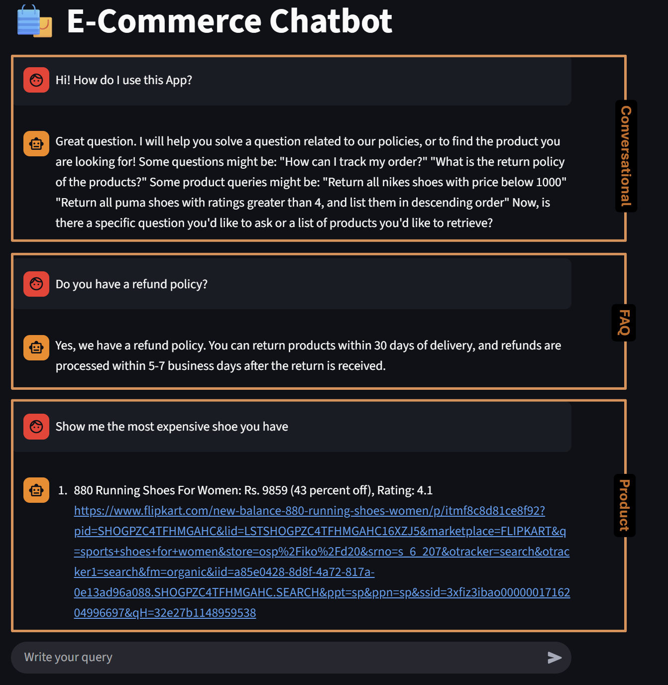
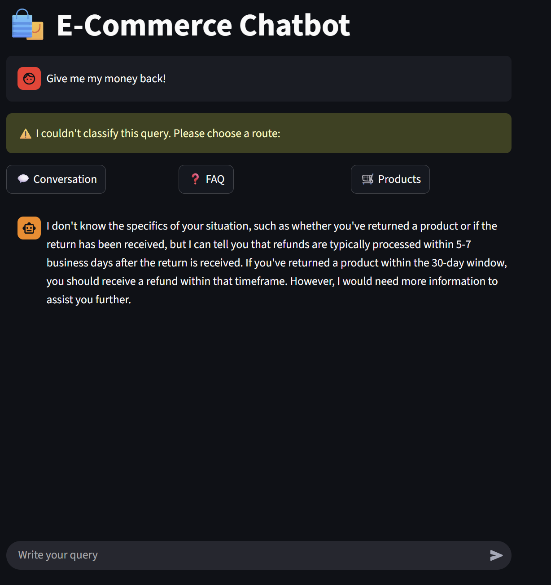
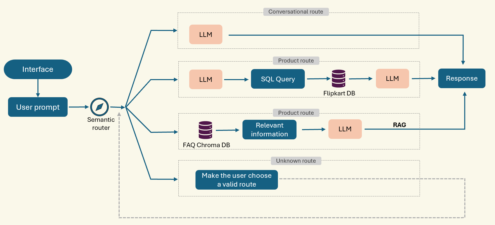

# 🛍️E-Commerce chatbot

## 🧩 General Overview

This project implements a functional AI-powered chatbot that provides customer assistance and serves as a product search assistant for shoes.
Using a prefetched FAQ database of 10 questions and a product database with 903 shoes from Flipkart, it helps users:

* Solve policy-related inquiries
* Search for specific shoes with given attributes

Frameworks used:

🧠 Chroma – Vector database for semantic FAQ storage

⚡ Groq – LLM execution framework

🦙 gpt-oss-120b – Model powering responses

## 💬 App Use

To live access the app you can use the following link https://e-commerce-chatbot-3gmpcpwtjidio4sghl9kdr.streamlit.app/. If the app is down let me knwo and I will inmidiately wake it up.

Type a question in the chat — it can be: A conversational message, a FAQ question, a product search query.
If the prompt is not correctly processed, the user can manually select how to route it:

  
  

## ⚠️ Limitations

* The app runs on Groq’s free trial, so token limits may occasionally pause responses until the next day.
* The bot is functional, not conversational — it focuses on completing tasks, not extended dialogues.

## ⚙️ Technical Overview

The user prompt is first classified by a semantic router, then processed based on the assigned workflow. Three routes are available:

* Conversation – The bot provides a short, friendly reply and invites further queries
* FAQ – Retrieves the most relevant chunks from the FAQ vector database and generates an answer
* Product – Transforms the user query into an SQL request and fetches matching shoes

For a complete technical explanation of each route. **See technical_description.md in the project root folder.**

## 🧱 Tech Stack

* Streamlit – Frontend framework
* ChromaDB – Vector database
* Groq API – LLM provider
* gpt-oss-120b – Large Language Model
